# Administrator Guide for the Conference Management System

This document describes how to use the administrative part of the conference management system. It is intended for website administrators responsible for reviewing participant submissions, publishing conference content, editing the public website, managing the conference schedule, and generating conference documents.

The system can host multiple conferences at the same time. Each conference has its own website, its own data, and its own documents. The administrative interface described in this guide always administers the conference whose website it was opened from. Creating conferences themselves is done in the Django administration; their basic facts (title, dates, location, badge title, card and hero photos) are edited in the admin panel. See the **Managing Multiple Conferences** chapter.

## Access to the Administrative Interface

### Open the Admin Area

The entry point to the administrative interface is located in the footer of the conference website.

> **Warning:** The admin panel is best used on a desktop or large screen. On smaller screens, the interface may be harder to navigate.

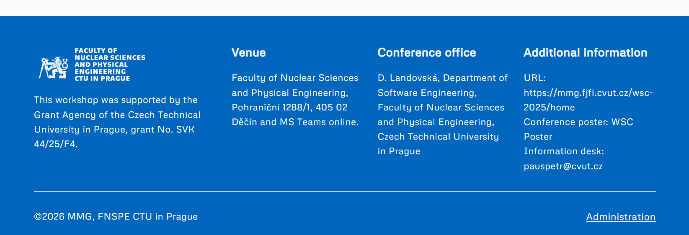

1. Open the conference website.
2. Scroll to the footer.
3. Select the administration link.
4. Sign in with one of the methods offered in the login window (see below).

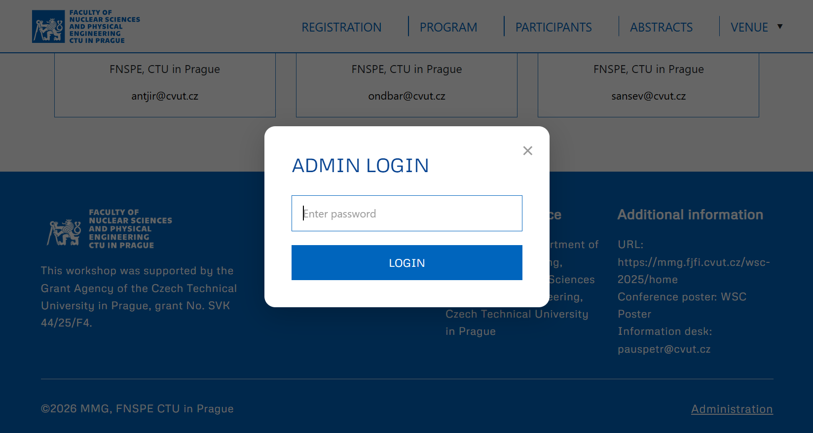

### Sign in with GitLab

Select **Sign in with GitLab** to sign in with the university GitLab. The browser redirects to the GitLab website and asks for the GitLab credentials there, and then returns to the conference website. The admin panel of the conference opens automatically after a successful sign-in.

GitLab is the standard way to sign in. Which options the login window offers depends on the deployment: when password sign-in is switched off, the login window shows only the GitLab button, and when GitLab sign-in is switched off, it shows only the username and password form. The optional password method is described in **Special Account Sign-in** below.

A successful GitLab sign-in opens both administrative interfaces at once: the admin panel of the conference website described in this guide, and the Django administration used for creating conferences (see **Managing Multiple Conferences**).

### Special Account Sign-in

When the deployment offers it, the login window shows a username and password form. When GitLab sign-in is enabled as well, the form is available inside the collapsible **Special account** section; when GitLab sign-in is disabled (a password-only deployment), the login window shows the form directly instead. It signs in a local account that was created by an administrator in advance; it never creates new accounts.

This method is kept for testing, for demo deployments, and as a fallback for the case when GitLab is unavailable. It can be disabled on the deployment; when it is disabled, the form does not appear in the login window at all.

### Leave the Admin Area

You can leave the administrative part of the website in two ways:

- Select **Logout** in the administrative interface. This also ends the sign-in on the server, so the session cannot be reused; a new sign-in is required to return.
- Select any section in the public website header. This leaves the admin panel but keeps the sign-in active.

## Administrator Accounts

### How Administrator Access Works

Signing in with GitLab uses the university GitLab account, but the sign-in only proves who the person is. It never decides who is an administrator: administrator rights are always granted manually by an existing administrator, in the Django administration. Membership in GitLab groups or projects has no effect, and matching e-mail addresses never connect accounts automatically.

This has two practical consequences:

- A person who signs in with GitLab for the first time gets a new user account in the system, without administrator rights. An administrator must promote it (see **Give a New Administrator Access** below).
- An administrator who previously signed in with a username and password, and now signs in with GitLab, gets a separate new account rather than the old one. The GitLab identity can be linked to the existing account (see **Linking a GitLab Account to an Existing Administrator Account** below).

### Give a New Administrator Access

1. Ask the person to open any conference website, enter the admin area, and sign in with GitLab once. This creates their user account.
2. Open the Django administration at `<root>admin/` (for example, `https://mmg-webapps.fjfi.cvut.cz/conference/admin/`) and sign in.
3. Open **Users** and find the newly created account (it carries the GitLab username).
4. Enable **Staff status** and save.

The person can now sign in with GitLab and use the admin panel of every conference.

### Linking a GitLab Account to an Existing Administrator Account

When an existing administrator starts signing in with GitLab, the first GitLab sign-in creates a new, separate account. The system does not merge the two automatically, because a matching e-mail address is not considered proof of identity. The link can be completed by hand in the Django administration:

1. Sign in with GitLab once, so the new account exists.
2. Open the Django administration and open **Social accounts**. Find the GitLab entry of the new account.
3. Change the **User** of that GitLab entry to the existing administrator account and save. GitLab sign-ins now open the existing account, with its administrator rights.
4. Open **Users** and delete the leftover account created by the first GitLab sign-in, if nothing references it.

Alternatively, the server operator can run a linking command on the backend; see the deployment guide.

> **Warning:** Linking only decides which account GitLab sign-ins open. It does not copy or change the administrator rights of either account.

## Admin Panel Overview

After a successful login, the system opens the administrative panel. The panel contains six main controls:

- Four links to administrative pages with editing and management functions.
- Two buttons for generating documents.

The administrative panel serves as the main navigation hub for all organizer tasks.

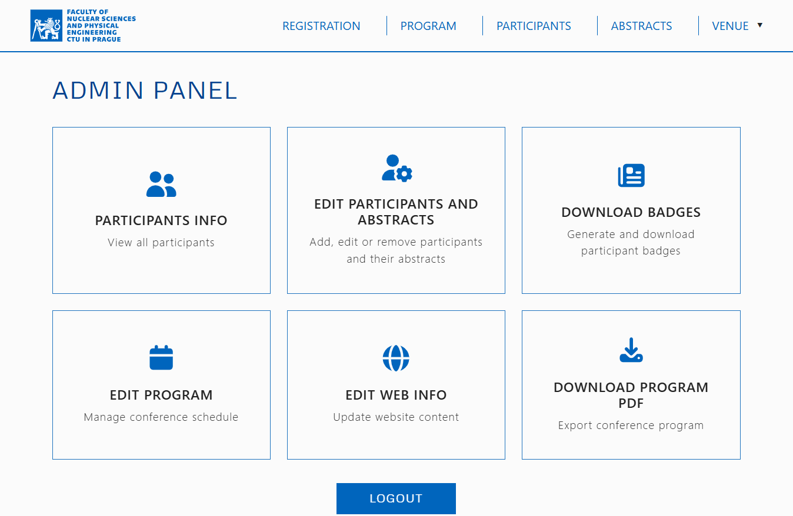

The panel also shows which conference is currently being administered. Under the panel title, the conference title and its slug are displayed, for example `Conference: Workshop on Scientific Computing 2026 (wsc2026)`. All changes made from the panel affect this conference only.

## Managing Multiple Conferences

### Overview

The root address of the deployment shows a landing page with one card per conference. The cards are grouped into **Running**, **Upcoming**, and **Past** conferences, based on the conference dates set in the admin panel of the conference website. The landing page is public and requires no login.

Each conference website lives at its own address:

```
<root>/<slug>/
```

For example, with the deployment root `https://mmg-webapps.fjfi.cvut.cz/conference/`, the conference with the slug `wsc2026` is available at `https://mmg-webapps.fjfi.cvut.cz/conference/wsc2026/`.

Select a card on the landing page to open the corresponding conference website.

All data of a conference belongs to that conference: its participants, submissions, program, accommodation, hiking routes, and website texts. Nothing is shared between conferences. The admin panel opened on a conference website can only see and change the data of that conference.

Administrator accounts are shared across conferences. A single staff account can administer every conference. This is intended; administrator sessions and cookies are not scoped per conference. How accounts are created and linked is described in **Administrator Accounts**.

### Creating a New Conference

Conferences are created in the Django administration. This is a separate interface from the admin panel described in this guide, and it requires a superuser account.

1. Open the Django administration at `<root>admin/` (for example, `https://mmg-webapps.fjfi.cvut.cz/conference/admin/`).
2. Log in with a superuser account. The Django administration has its own sign-in page, which offers the same sign-in methods as the conference admin panel (see **Access to the Administrative Interface**).
3. Select **Conferences**.
4. Select **Add Conference**.
5. Fill in the fields described below.
6. Select **Save**.

The creation form asks only for one field:

- **Slug**: the web address of the conference. The conference becomes available at `<root>/<slug>/`. The slug must be unique. The words `auth`, `admin`, `api`, `conferences`, `media`, and `static` are reserved and cannot be used.

After saving, the new conference appears on the landing page immediately and is available at its own address `<root>/<slug>/`. The conference starts empty. Organizers then open its website, enter the admin panel there, fill in its logistics (see below), and build the content as usual.

#### Conference Fields

The logistics fields of a conference are edited in the admin panel of the conference website, in **Edit Web Info** (see **Changing Conference Logistics** below), not in the Django administration:

- **Title**: the full conference name. It is shown on the landing card and in the website header. It is also used as the badges header when the badge title is empty.
- **Start date** and **End date**: shown as the date range on the landing card. They determine whether the conference is grouped as Running, Upcoming, or Past on the landing page. A conference that does not have both dates is treated as Upcoming. The year displayed with the conference is derived from the start date.
- **Location**: shown on the landing card and printed in the footer of the badges PDF.
- **Card photo**: the image shown on the landing card.
- **Hero photo**: an optional hero image for the conference.
- **Short description**: a one-line description shown on the landing card.
- **Badge title**: the header printed on the badges PDF. When this field is empty, the conference title is used instead.

### Changing Conference Logistics

The logistical facts of a conference (title, dates, location, card and hero photos, short description, badge title) are edited in the admin panel of the conference website, in **Edit Web Info**.

1. Open the conference website (`<root>/<slug>/`).
2. Enter the admin panel from the footer.
3. Open **Edit Web Info**.
4. Change the required fields in the logistics block at the top of the form.
5. Select **Save Changes**.

Website texts such as the homepage description, registration instructions, venue description, and footer are edited in the same form, as described in the **Edit Website Information** chapter. Only the slug is managed in the Django administration.

### Deleting a Conference

A conference can be deleted in the Django administration only while nothing references it. Participants, abstracts, submissions, people, accommodation options, hiking routes and stops, conference days, sessions, and talks all belong to exactly one conference and are deleted together with it. The delete action is therefore offered only after every related record has been removed.

The conference settings (logistics, website texts, and the accommodation description) are part of the conference record itself, so they never block the deletion and are removed with it.

In normal operation a finished conference does not need to be deleted: once its end date has passed it moves to the **Past** group on the landing page automatically.

### Documents Are Per-Conference

Both document-generation buttons in the admin panel work on the conference you are currently administering:

- **Download Badges** produces badges from the approved submissions of the current conference. The badge header shows the conference badge title (or title), and the footer shows the conference location.
- **Download Program PDF** produces the program from the schedule of the current conference.

Generating documents on two different conferences never mixes their data.

### Old Bookmarks

The root address always shows the landing page. A bookmark to an old address such as `<root>/#/program` therefore opens the landing page instead of the expected conference page. Select the required conference card to continue.

Update bookmarks to the full conference address, for example `<root>/wsc2026/#/program`.

### Unknown Conference Addresses

An address whose conference slug matches no existing conference, for example `<root>/typo-in-the-slug/`, also shows the landing page — the conference websites are only served for real conferences. A red banner at the top of the landing page names the slug that was not found. Select the required conference card to continue, or fix the slug in the address.

## Participants Info

### Purpose

The first administrative page displays all users who completed the registration form. Its purpose is to provide a clear overview of submitted registrations in a readable format.

### Available Information

Each item displays:

- Participant information.
- Arrival and departure dates.
- Additional information provided by the participant (dietary restrictions, accessibility needs, etc.).

The list is ordered alphabetically by participant surname; each full name is displayed as entered.

### Important Note

This page is not interactive. It is intended only for reading information. To modify participant data, use the **Edit Participants and Abstracts** section.

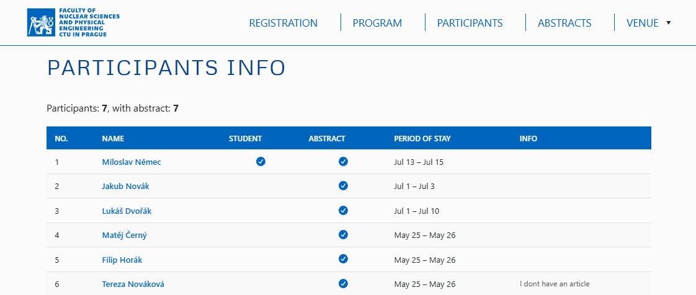

## Edit Participants and Abstracts

### Purpose

The **Edit Participants and Abstracts** section contains the complete information about participant submissions and their abstracts. This section is used for reviewing, editing, publishing, rejecting, filtering, and restoring submissions. Submissions are listed alphabetically by participant surname.

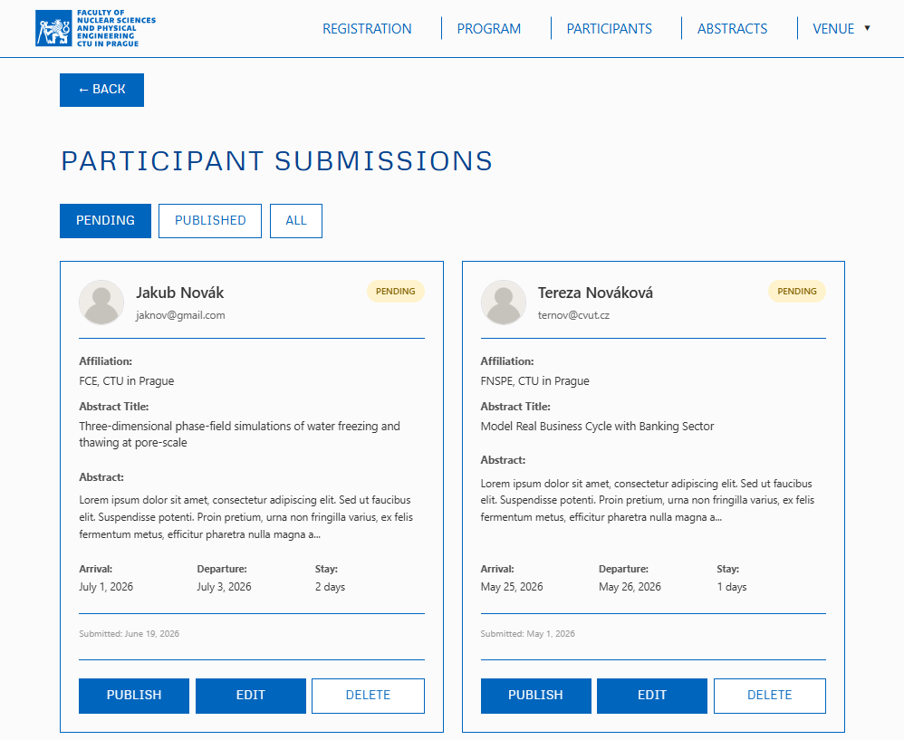

### Open a Participant for Editing

1. Open **Edit Participants and Abstracts**.
2. Find the participant card.
3. Select **Edit** on the participant card.
4. Review or update the participant and abstract data, including the student flag and the participant's additional information.
5. Confirm the action in the modal window if prompted.


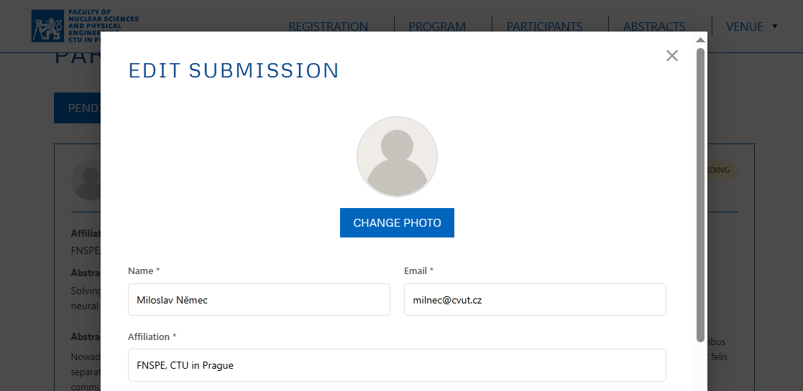

### Publish a Submission

Publishing makes the participant and, for talks and posters, the abstract visible in the public part of the website.

Before publishing, the following fields must be filled in:

- Name
- Affiliation
- Date of arrival
- Date of departure

For a **Talk** or **Poster**, a **Title** is also required. The abstract text is optional.

To publish a submission:

1. Open **Edit Participants and Abstracts**.
2. Find the required submission.
3. Review the participant and abstract information.
4. Make sure all required fields are completed.
5. Select **Publish**.

### Result of Publication

After publication:

- The participant appears in the public part of the website.
- A **Talk** creates an abstract and an unpublished schedule item without an assigned presentation time.
- A **Poster** creates an abstract and an unpublished poster schedule item. Schedule it into a poster session in **Edit Program**.
- **Just attend** creates only the participant; no abstract or schedule item is created.

After publishing a talk or poster, the presentation time is still not set. To assign the time, continue to **Edit Program**.

Changing a published submission's participation type updates the public records:

- **Talk → Poster** keeps the abstract and turns the unscheduled talk into a poster item.
- **Poster → Talk** keeps the abstract and turns the poster item into a talk. If the poster was placed in a poster session, it is detached and becomes unscheduled, so schedule it again.
- **Talk or Poster → Just attend** removes the abstract and the schedule item.
- A talk that is already scheduled must be unscheduled before the submission can be changed to a poster or to just attend.

Create a **Poster session** in **Edit Program** with its own shared time slot; all posters in that session use the same slot, and the chair is optional. It is shown as a **Poster session** in the program. A session's type cannot be changed after creation; create a new session of the required type instead. Each abstract shown on the public abstracts page carries a **TO THE PROGRAM** button. Talks jump to and highlight their program row; posters jump to and highlight their poster session. The button is hidden while the program is not ready (the conference has no scheduled days yet) and appears once at least one conference day has been created.

### Edit an Already Published Submission

Published submissions can still be edited.

To find them:

1. Open the filter at the top of the page.
2. Select **Published** or **All**.
3. Find the required participant.
4. Open the record through **Edit**.
5. Save the changes.

Changes made to an already published submission are reflected immediately in the public part of the website.

### Unpublish a Submission

Published submissions have an **Unpublish** action. It removes the public Participant and Abstract, together with any scheduled program item, but keeps the submission in **Pending** state so it can be edited and published again. To reject a pending registration instead, use **Reject registration**.

Deleting a **participant** in the Django administration also unpublishes every linked submission. Those submissions stay in **Edit Participants and Abstracts** as **Pending**, while the public participant, abstract, and any linked talk — including scheduled program items — are removed. Use **Unpublish** from Edit Participants when you want to do this for one submission; use Django admin deletion when you are removing the participant record itself.

### Reject a Registration

Rejecting keeps the submission stored but removes it from the review workflow. It is intended for registrations that should not be published; it does not delete the participant data.

1. Open **Edit Participants and Abstracts**.
2. Find the required pending submission.
3. Select **Reject registration**.
4. Optionally enter a message for the participant.
5. Confirm the action.

Rejected submissions appear only under the **Rejected** tab. They are excluded from **Pending**, **Published**, and **All**, so they no longer appear in the normal review queue.

The participant can still open the tracking link and see the **Rejected** status and the optional message. Rejected submissions cannot be edited through the tracking link. Administrators can still edit them in the Django administration.

### Restore a Rejected Registration

1. Open the **Rejected** tab.
2. Find the required submission.
3. Select **Restore**.
4. Confirm the action.

The submission returns to **Pending** and the rejection message is cleared.

### Permanently Delete a Submission

Permanent deletion is available only in the Django administration. Open **Participant submissions**, select the record, and use the Django admin delete action.

Deletion is irreversible. Deleting a published submission also removes its public Participant, Abstract, and any linked talk. To keep the data but remove a registration from the review workflow, use **Reject registration** instead.

### Participant Tracking Links and Self-Service Edits

Every submission carries two identifiers that connect the participant with their registration:

- A **participant reference** in the form `<slug>-<number>`, for example `wsc2026-0042`. The number is assigned automatically and never changes.
- A **tracking link** in the form `<root>/<slug>/#/track/<token>`. The link is personal to the one submission and opens without a login.

When a participant submits the registration form, the confirmation screen shows the reference and the tracking link, together with a **Copy link** button and a warning to save the link. The link is the only way for the participant to reach their submission again, so participants are asked to keep it.

Opening the tracking link shows the participant their own submission: the reference, the current status (**Pending review**, **Published**, or **Rejected**), the submitted details, and, while submission editing is open and the submission is not rejected, an **Edit submission** button. Through this form, participants correct their own details (name, affiliation, email, abstract, arrival and departure dates, photo) without contacting the organizers. Editing is governed by the **Submission Editing Deadline** (see the **Registration** subsection), which is independent of the registration window: participants can keep editing after registration has closed, up to that date.

A rejected submission still shows its details, status, and the organizer's optional message, but the edit form is never available. This is enforced by the backend as well as by the hidden button.

For administrators, participant self-service edits have the following consequences:

- When a participant edits a submission that is already published, the submission automatically returns to the **Pending review** state. The public participant and abstract entries are not changed by the participant's edit; they keep the previously published data. (Edits made by administrators in **Edit Participants and Abstracts** are different; see **Edit an Already Published Submission** above.)
- The public entries are refreshed only when the submission is published again. Re-publishing also transfers the participant's edits to the public website: the public participant entry is updated to match the submission (name, affiliation, email, and photo; a photo is replaced only when the submission has one).
- Re-publishing sends the automated publication email again. This is expected behavior: every transition of a submission into the published state sends the email, including re-publication after a participant edit.

The conference end date always ends editing: once the conference has ended (or the submission-editing deadline has passed), the tracking link still shows the submission and its status, but the edit form is replaced by a notice that online editing is closed. When no submission-editing deadline is set, editing closes automatically the day before the conference start date (and stays open only if no start date is set either).

If a participant loses the tracking link, it can be recovered from the administrative interface:

1. Open **Edit Participants and Abstracts**.
2. Find the participant card. Every card shows the participant reference.
3. Select **Copy tracking link** on the card.
4. Send the copied link to the participant.

The copied address opens the participant's submission directly; no login is required on either side.

Each submission also carries a `linked_user` field, visible in the Django administration and in the API. It is an optional connection between a submission and a user account. It is not used by any current feature of the conference website; it exists as a reserved seam for possible future login-based access to submissions. It can be set only in the Django administration or through the API, never by participants themselves.

### Import Pre-Registered Participants

Participants who were collected before registration opened (for example an early-bird list kept by e-mail) can be added in bulk from a CSV file. The import creates a **pending** submission for each row, exactly as if the participant had filled in the registration form themselves; nothing is e-mailed to anybody.

The import lives in the **Django administration**, not in the conference website: open **Participant submissions** and select **Import CSV** in the top-right corner.

A CSV column is matched to a participant field automatically when its name matches the field name, ignoring capital letters and spaces. For example, a column called `Name` fills the participant name, `Email` the e-mail, `Abstract Title` (or `abstract_title`) the title, and `Admin Notes` the internal admin notes. The available fields are the participant-submission fields: name, e-mail, affiliation, title, abstract, contribution type, additional authors, additional affiliations, arrival and departure dates, admin notes, additional info, and the student flag. **Name** and **Email** are required; everything else is optional. The contribution type accepts `Talk`, `Poster`, or `Just attend` (also the Czech `přednáška` and `účast`); when the column is absent or empty, it is inferred as Talk when an abstract is present and Just attend otherwise. CSV import and the Django administration are administrative overrides: they do not enforce the conference's **Allowed Contribution Types** setting. The conference website, participant tracking links, and the conference admin panel enforce it. The student flag accepts `yes`/`no` (also `true`/`false`, `y`/`n`, `1`/`0`, and `ano`/`ne`); an empty cell is treated as `no`, and any other value is an error. A `photo` column is ignored, because photos are added later.

Columns that do not match a field name are shown on the preview screen, where each can be mapped to a field by hand — for example, mapping a column called `Topic / Title (Tentative, for all now)` to **Title**. Several columns can be mapped to **Admin notes**; their values are merged, one per line (empty cells are dropped). Every other field accepts a single column.

The file may be comma-, semicolon-, or tab-separated, and may be UTF-8 or Windows-1250 encoded (the encoding Excel commonly produces for Czech text). The file must be at most 2 MB and contain at most 10,000 data rows.

To import:

1. Open **Participant submissions** in the Django administration.
2. Select **Import CSV**.
3. Choose the conference for which the participants are being imported.
4. Choose the CSV file and select **Preview**.
5. Under **Map columns**, map any unmatched column to a field, then select **Update preview** to see the effect. Repeat until the mapping is right.
6. Review the table. Each row is shown with its mapped values and a status:
   - **ok** — the row will be imported.
   - **warning** — the row is a duplicate and will be skipped.
   - **error** — the row is missing a required value or is otherwise invalid, and will be skipped.
7. Select **Confirm import**.

Nothing is saved until **Confirm import** is pressed; **Preview** and **Update preview** only display what will happen.

A row is treated as a duplicate, and skipped, when its e-mail address already appears earlier in the same file or already exists in the selected conference (as a submission or as a published participant). Because of this, the import can be run again safely: already-imported rows are skipped instead of duplicated.

Arrival and departure dates default to the conference start and end dates. The conference start and end dates must therefore be set (in **Edit Website Information**) unless the file maps its own arrival-date and departure-date columns; otherwise the import is refused with an error. A mapped date column must use the `YYYY-MM-DD` format; an empty date cell falls back to the conference dates (or is an error if the conference has none).

Imported submissions are **pending**, so they are not visible on the public website yet. Each one already carries its tracking link, so the personal links can be distributed to the participants right away (see **Participant Tracking Links and Self-Service Edits** above). When the time comes to show the participants and their tentative titles publicly, select the imported submissions in **Edit Participants and Abstracts** and use **Publish selected submissions**.

## Edit Program

### Overview

The **Edit Program** section contains two main parts:

- **Unscheduled Talks**
- **Conference Schedule**

This section is used to create conference days, create chairs, assign talks to the schedule, add breaks, and modify already scheduled items. The explanatory text shown on the public program page is edited here as well; see **Edit the Program Page Text** below.

### Unscheduled Talks Section

The **Unscheduled Talks** section displays published submissions whose presentation time has not yet been assigned.

The **Move to Unscheduled** action moves a talk from the schedule back to the **Unscheduled Talks** section. The talk becomes invisible in the public part of the website until it is assigned again.

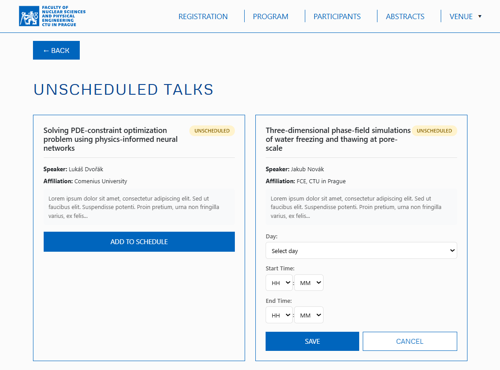

### Assign a Talk to the Schedule

1. Open **Edit Program**.
2. In **Unscheduled Talks**, find the talk that should be scheduled.
3. Select **Add to Schedule**.
4. Select the conference day.
5. Select the chair.
6. Enter the start time.
7. Enter the end time.
8. Select **Save**.

### If the Required Day Does Not Exist

If the needed conference day is missing, create it first in the **Conference Schedule** section using **Add Day**.

### If the Required Chair Does Not Exist

If the needed chair is missing:

1. Verify that the correct conference day is selected.
2. If the correct day is selected and the chair is still missing, create a new chair in the **Conference Schedule** section.

### Conference Schedule Section

The **Conference Schedule** section displays the conference days as separate cards. Each card contains the talks, breaks, and chairs assigned to that day.

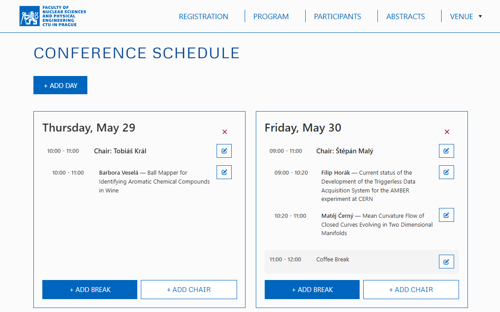

### Add a New Conference Day

1. Open **Edit Program**.
2. In **Conference Schedule**, select **Add Day**.
3. Choose the required date.
4. Select **Save**.

A conference day can be deleted using the cross icon in the upper right corner of the corresponding day card.

### Warning

Before deleting a conference day, make sure that all talks are moved to **Unscheduled Talks**. Otherwise, the talks assigned to that day may be deleted together with it.

### Add a New Chair

1. Find the card of the required conference day.
2. Select **Add Chair** at the bottom of the card.
3. Enter the chair name.
4. Select **Save**.

### Important Note About Chairs

A newly created chair appears in the actual schedule only after at least one talk is assigned to that chair, or after a previously scheduled talk is changed to that chair.

The chair time is calculated automatically from the times of the talks assigned to that chair.

### Edit or Delete a Chair

1. Find the required chair.
2. Select the icon on the right side of the chair.
3. Edit the chair name or delete the chair.

### Result of Chair Deletion

If a chair is deleted, all talks assigned to that chair remain in the system, but they become talks without a chair. They are not deleted and remain visible in the public part of the website.

### Move a Chair to Another Day

To move a chair to another day:

1. Delete the chair from the current day.
2. Create the chair again in the required day.

The talks assigned to that chair are not moved together with the chair. After deletion, they become talks without a chair.

### Add and Edit Breaks

#### Add a Break

A break is used for schedule items that do not have a speaker and are not related to abstracts.

1. Open **Edit Program**.
2. Select **Add Break**.
3. Enter the start time.
4. Enter the end time.
5. Select **Save**.

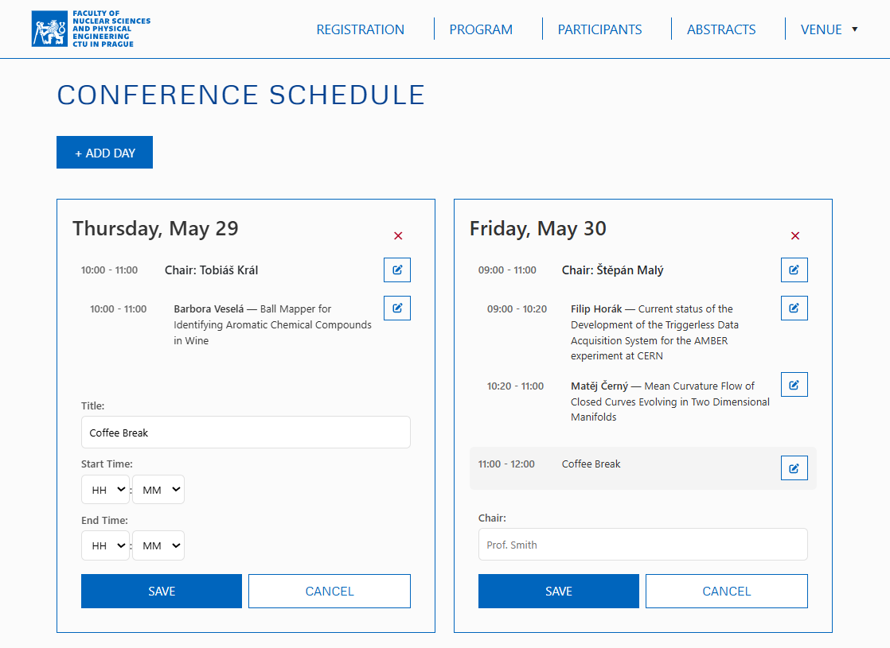

#### Edit a Talk or Break

To change the time or chair of any talk or break:

1. Find the required talk or break.
2. Select the pen icon on the right side.
3. Update the required values.
4. Save the changes.

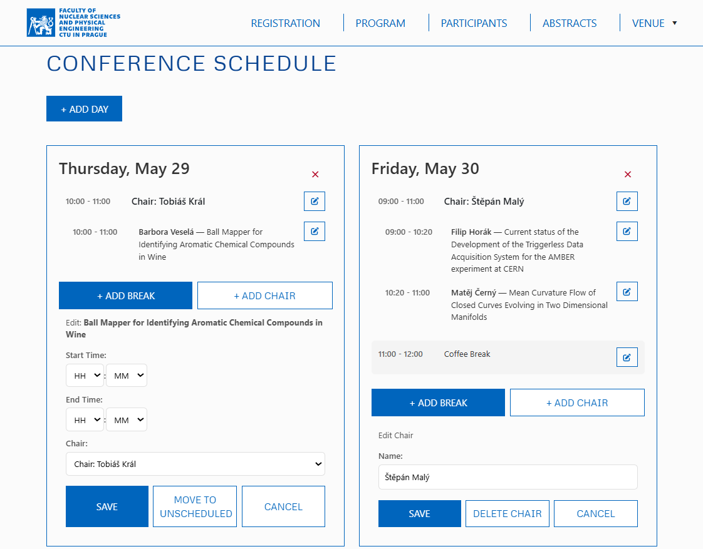

### Important Note About Moving a Talk

To move a talk to another day, select **Move to Unscheduled**. The talk is then moved to the **Unscheduled Talks** section and becomes invisible in the public part of the website. From there, assign it again to the required day, time, and chair.

### Edit the Program Page Text

The public program page shows a short explanatory text above the schedule. It is edited from the program editor.

1. Open **Edit Program**.
2. In the **Conference Schedule** section, select **Edit Page Text** next to **Add Day**.
3. Change the **Program Page Text**. Markdown formatting is supported (headings, lists, emphasis, links).
4. Select **SAVE CHANGES**.

## Edit Website Information

### Overview

The **Edit Web Info** section is used to update the content displayed in the public part of the application. It is divided into subsections corresponding to the user-facing parts of the website.

### Home Subsection

Use the **Home** subsection to update the description displayed on the homepage of the conference.

1. Open **Edit Web Info**.
2. Open the **Home** subsection.
3. Change the description in the input field.
4. Select **Save Changes**.

After saving, the updated description is displayed in the public part of the website.

The conference title, dates, location, badge title, and card and hero photos are edited in the logistics block at the top of the same form; see **Changing Conference Logistics** in **Managing Multiple Conferences**.

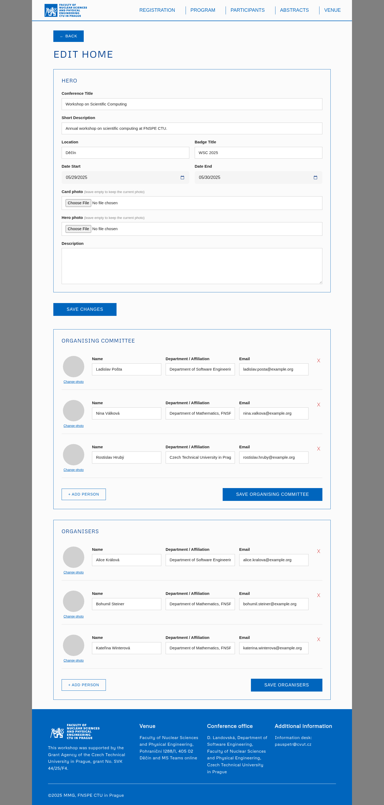

### People Card

The **People** card allows you to manage the people shown on the public website as organisers and as members of the organising committee. Each conference keeps its own list of people, and every person is stored as a single record with one or more roles. The roles are chosen with the **Organiser** and **Organising Committee** checkboxes, so the same person can hold both roles without being entered twice.

If a person has a public email address, it is shown on the website as a `mailto:` link.

Available actions:

- Change a photo using **Change Photo**.
- Add a new person using **Add Person** at the bottom of the card.
- Delete a person using the cross icon on the right side of the required record.

After making changes, select **Save** at the bottom of the card. The changes are not applied until the card is saved.

A person record can optionally be linked to an existing user account. This link is set in the Django administration, not in this editor; it is reference-only, and the person's name and email stay editable in the **People** card.

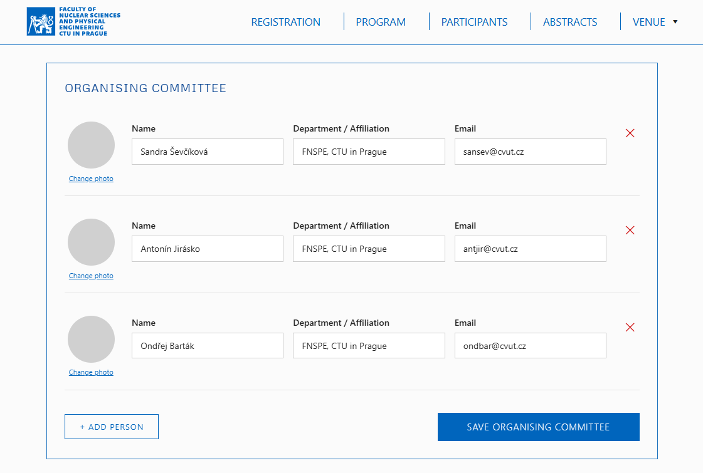

### Optional Photo Cropping

Wherever a photo is picked — in the registration form, in the tracking link's **Edit submission** form, in the admin **Edit submission** modal, and in the **People** card — the picked photo shows a preview and an optional **Crop…** button.

Selecting **Crop…** opens a dialog with the photo. Drag the square over the photo to frame the part to keep, then select **Crop & Save** to upload the square crop, or **Keep Original** to keep the photo exactly as picked. Cropping is always optional; without it the photo is uploaded as picked.

The crop is saved as a **JPEG up to 1024 px** on its longest side. Because the photo is re-encoded, embedded metadata such as EXIF and GPS data is removed. If the crop cannot be produced, the photo is uploaded exactly as picked — which is also what choosing **Keep Original** does.

### Registration Subsection

Use the **Registration** subsection to update the registration page text and the registration window.

1. Open the **Registration** subsection.
2. Modify the relevant input fields.
3. Select **Save**.

After a successful submission, the public registration form is replaced by a confirmation screen showing the participant reference and the personal tracking link; see **Participant Tracking Links and Self-Service Edits** in **Edit Participants and Abstracts**.

The registration form asks for a participation type: **Talk**, **Poster**, or **Just attend**. **Talk** is selected by default. Talk and poster submissions show the title and abstract fields; the title is required for both. **Just attend** hides them and creates no abstract or talk when published.

**Allowed Contribution Types** controls which of the three options the form offers; at least one must stay enabled. Existing submissions keep their type if an option is later disabled.

The registration window has two optional dates. The **Registration Opening Date** is the first day the registration form is available; before it, the public registration form is replaced by a "not open yet" notice. The **Registration Deadline** is the last day the form is available; after it, the form is replaced by a "registration closed" notice. Outside the window the backend also rejects submission attempts directly, so the form cannot be bypassed. When both dates are empty, registration is open — but a conference whose end date has passed always has closed registration, even without a deadline.

The **Submission Editing Deadline** is an independent optional date that controls how long participants can edit their own submission through the personal tracking link (see **Participant Tracking Links and Self-Service Edits** in **Edit Participants and Abstracts**). Participants can keep editing until this date even after registration has closed. The deadline must fall on or after the registration deadline and on or before the conference end date (when those dates are set), because the conference end date always ends editing — even a later deadline cannot keep editing open past the end of the conference. When the field is empty, editing closes the day before the conference starts, based on the conference start date; if no start date is set either, editing stays open.

While the current date is more than one month before the **Submission Editing Deadline** — or, when no deadline is set, more than one month before the conference start date — the public registration form labels the arrival and departure date fields as **Arrival Date (tentative)** and **Departure Date (tentative)**. Within the final month before that reference date the labels drop the "(tentative)" suffix.

### Venue Subsection

Use the **Venue** subsection to update the venue description, the optional venue photo, and the embedded map. The venue description supports Markdown formatting (headings, lists, emphasis, links); it is rendered as formatted text on the public Venue page and in the editor's live preview. This description is independent of the footer's **Venue Text** (see **Footer Subsection**), which is a separate plain-text field. The venue photo is shown on the public Venue page between the description and the map.

1. Open the **Venue** subsection.
2. Modify the relevant input fields.
3. Select **Save**.

#### Google Maps Embed Instruction

To copy the map link from Google Maps:

1. Open Google Maps.
2. Select **Share**.
3. Select **Embed a map**.
4. Copy the `src` value from the iframe code.
5. Paste it into the appropriate field in the admin interface.

### Accommodation Subsection

Use the **Accommodation** subsection to update the description shown at the top of the accommodation page and to manage accommodation options.

#### Change the Accommodation Description

The description supports Markdown formatting (headings, lists, emphasis, links) and is rendered as formatted text at the top of the public accommodation page.

1. Edit the input field in the accommodation subsection.
2. Select **Save**.

#### Edit Accommodation Options

Each accommodation option card allows you to:

- Edit text inputs.
- Change the photo using **Change Photo**.
- Change the display order using the **Order** input.
- Delete the option using the cross icon.

The option with the lowest order number is shown first on the public website. Option descriptions support Markdown formatting (headings, lists, emphasis, links).

#### Add a New Accommodation Option

1. Select **Add Option** at the bottom of the card.
2. Fill in the required information.
3. Save the card.

After all changes, select **Save** at the end of the card.

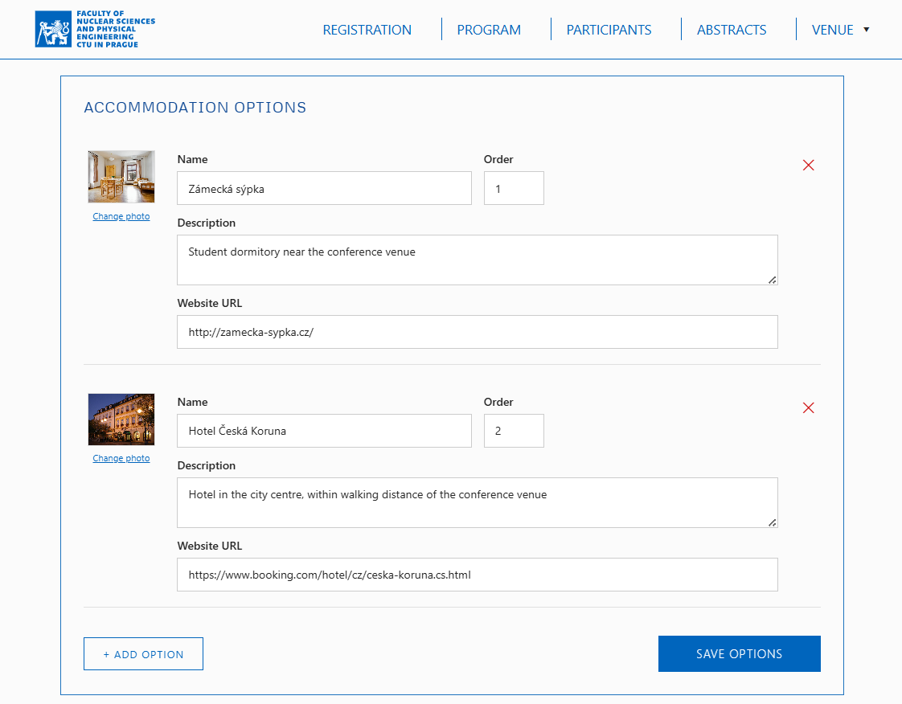

### Hiking Subsection

The **Hiking** subsection is organized into routes, and each route contains several stops.

#### Edit a Route

The route's **Way Description** supports Markdown formatting (headings, lists, emphasis, links).

1. Open the required route card.
2. Change the corresponding input fields.
3. Select **Save Route**.

#### Delete a Route

1. Open the required route card.
2. Select the red **Delete Route** button in the upper right corner.

### Warning

Deleting a route also deletes all stops contained in that route.

#### Add a New Route

Select **Add Route** at the end of the page.

#### Edit Stops

Inside a route, each stop can be updated.

Available actions:

- Edit text inputs.
- Change the photo using **Change Photo**.
- Change the display order using the **Order** input.
- Delete the stop using the cross icon.
- Add a new stop using **Add Stop**.

The stop with the lowest order number is shown first. Stop descriptions support Markdown formatting (headings, lists, emphasis, links).

After making changes to stops, select **Save** at the end of the card.

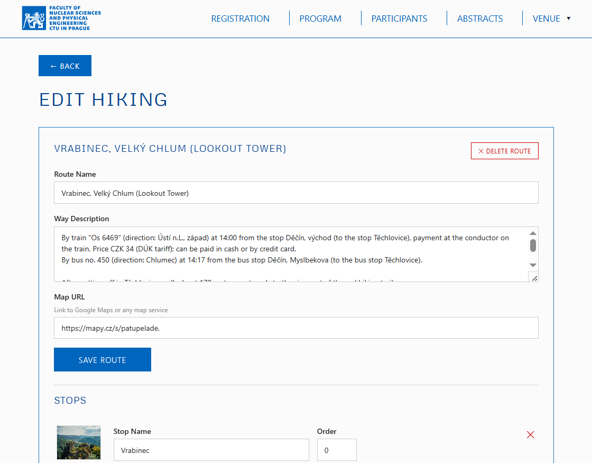

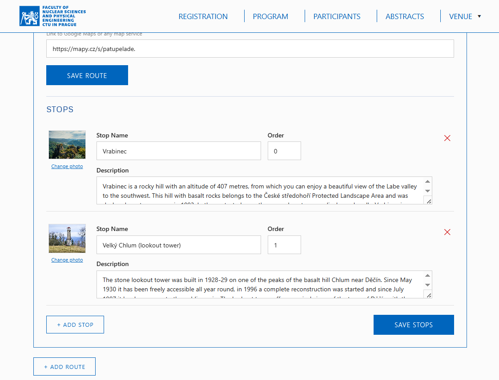

### Footer Subsection

Use the **Footer** subsection to update the information shown in the footer of the website.

1. Open the **Footer** subsection.
2. Modify the required input fields.
3. Select **Save** at the end of the card.

The footer is displayed at the bottom of every public page. The footer's **Venue Text** is a separate field from the Venue page description and is shown as plain text (no Markdown); the two fields can hold different content.

### Generate Documents

The admin panel contains two document-generation buttons:

- **Download Badges**
- **Download Program PDF**

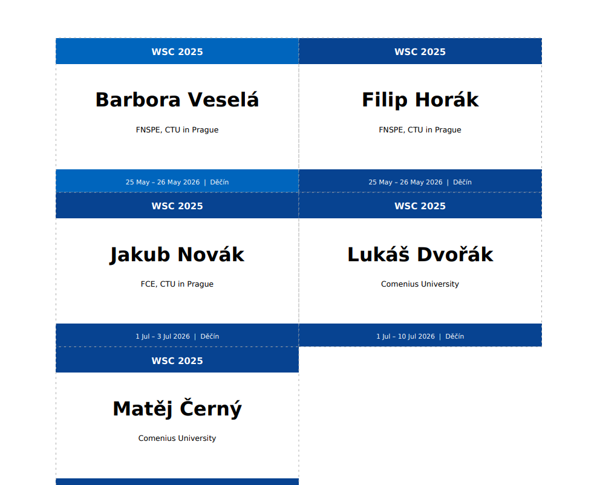

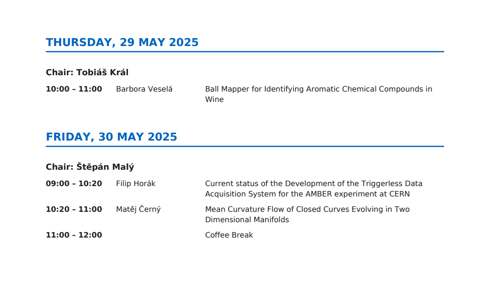

#### Download Badges

When you select **Download Badges**, the system automatically downloads participant badges in PDF format.

The badge data is generated automatically from published submissions of the conference you are currently administering. To change badge information, update the corresponding participant data in **Edit Participants and Abstracts**.

The header of the badges PDF shows the conference badge title, or the conference title when the badge title is empty. The footer shows the conference location. To change these values, edit the logistics in **Edit Web Info**; see **Changing Conference Logistics** in **Managing Multiple Conferences**.

#### Download Program PDF

When you select **Download Program PDF**, the system automatically downloads the conference program in PDF format.

The program PDF is generated from the currently published schedule of the conference you are currently administering. To change the exported program, update the schedule in **Edit Program**.

## Operational Recommendations

### Before Publishing a Submission

Always verify that the following fields are filled in correctly:

- Name
- Affiliation
- Participation type
- Title (for Talk and Poster)
- Arrival date
- Departure date

### Before Generating Badges

Make sure all published participant information is correct, because badge data is taken from published submissions. Also check the conference badge title and location in **Edit Web Info**, because these values are printed on every badge.

### Before Generating the Program PDF

Make sure all talks are assigned to the correct days, chairs, and times, because the exported PDF is based on the current published schedule of the conference you are administering.

## Common Situations

### A Published Participant Is Not Visible in the Program

Publication alone is not enough. After publication, the talk still has no assigned time. Open **Edit Program** and assign the talk in **Unscheduled Talks**.

A **Poster** appears in the program only after its poster schedule item is placed in a session; that session is shown as a **Poster session**. A **Just attend** participant never appears in the program and has no contribution at all.

### A Just attend Participant Is Not in the Abstracts

This is expected. Abstract and title fields are only used for Talk and Poster submissions; a just-attend participant creates no abstract row.

### The Required Chair Does Not Appear During Scheduling

First verify that the correct conference day is selected. If the day is correct and the chair is still missing, create the chair in **Conference Schedule**.

### Changes on the Public Website Are Not Visible

For content editing pages, check whether the correct **Save** or **Save Changes** button was pressed in the relevant card or subsection.

### An Old Bookmark Opens the Landing Page

The root address always shows the landing page. Select the required conference card to continue, or update the bookmark to the full conference address, for example `<root>/wsc2026/#/program`.

### The Wrong Conference Is Being Edited

The admin panel always administers the conference whose website it was opened from; the conference title and slug are shown under the admin panel title. To edit a different conference, leave the admin area, return to the landing page, and open the other conference website.

## Note

This guide covers the standard administrative workflows of the implemented conference management system. If the application is extended in the future, the guide should be updated so that it remains consistent with the current administrative interface.
